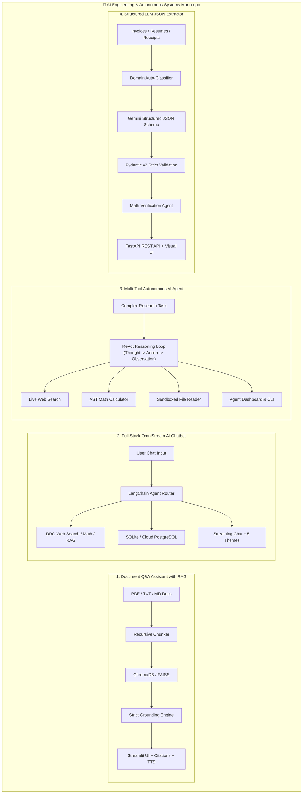

# 🤖 Advanced AI Engineering & Autonomous Systems Suite

[](https://www.python.org/)
[](https://fastapi.tiangolo.com/)
[](https://streamlit.io/)
[](https://python.langchain.com/)
[](https://ai.google.dev/)
[-brightgreen.svg)]()
[](https://opensource.org/licenses/MIT)

> A production-grade monorepo showcasing four state-of-the-art Artificial Intelligence and Large Language Model (LLM) applications. Engineered with modern architectures including **Retrieval-Augmented Generation (RAG)**, **Autonomous ReAct Agent Loops**, **Real-Time Token Streaming**, and **Constrained JSON Schema Extraction**.

---

## 📂 Suite Projects Overview

This repository unites 4 independent, production-ready AI applications. Each project contains its own isolated package structure, tests, CLI/Web interfaces, and deployment configurations:

| # | Project Name | Primary Stack | Core AI Architecture | Web UI | CLI | Cloud Deployment |
|---|:---|:---|:---|:---:|:---:|:---|
| **1** | [**Document Q&A Assistant with RAG**](./Document%20Q&A%20Assistant%20with%20RAG%20&%20Vector%20Embeddings/) | LangChain, ChromaDB, FAISS, PyPDF, Streamlit | Multi-Query RAG, Exact Page Citations, Anti-Hallucination Guardrails, Audio TTS | ✅ | ✅ | Streamlit Community Cloud |
| **2** | [**Interactive AI Chatbot (OmniStream)**](./Interactive%20Full-Stack%20AI%20Chatbot%20with%20Streamlit/) | Streamlit, LangChain, DuckDuckGo, PostgreSQL | Word-by-Word Token Streaming, Tool Routing, CoT Reasoning, 5 Dynamic Themes | ✅ | — | Streamlit Community Cloud |
| **3** | [**Multi-Tool Autonomous AI Agent**](./Multi-Tool%20Autonomous%20AI%20Agent/) | ReAct Pattern, LangChain, DuckDuckGo, SymPy | Thought-Action-Observation Loop, Sandboxed Local File Reader, Math Calculator | ✅ | ✅ | Streamlit Community Cloud |
| **4** | [**Structured LLM Extractor & API**](./Structured%20LLM%20Prompt%20Pipeline%20&%20JSON%20Extractor/) | FastAPI, Pydantic v2, Google Gemini, Uvicorn | Deterministic JSON Schema Extraction, Domain Auto-Classifier, Math Audit Agent | ✅ | ✅ | Render (Free Web Service) |

---

## 🏛️ High-Level System Architectures



---

## 🗂️ Monorepo Directory Layout

```
.
├── .gitignore                                                # Root gitignore protecting all .env & .venv
├── README.md                                                 # Master repository documentation (You are here)
│
├── Document Q&A Assistant with RAG & Vector Embeddings/      # PROJECT 1: Enterprise RAG System
│   ├── app.py                                                # Streamlit web application with audio TTS
│   ├── cli.py                                                # Terminal CLI for ingestion, stats, and chat
│   ├── GETTING_STARTED.md                                    # Beginner-friendly setup & running guide
│   ├── README.md                                             # Detailed technical specification
│   ├── requirements.txt                                      # Pinned dependencies
│   ├── sample_docs/                                          # Sample PDF/TXT docs for testing
│   ├── src/                                                  # Modular RAG & Vector store logic
│   └── tests/                                                # 16 Pytest tests (100% pass)
│
├── Interactive Full-Stack AI Chatbot with Streamlit/         # PROJECT 2: OmniStream AI Chatbot
│   ├── app.py                                                # Streamlit streaming chatbot app
│   ├── GETTING_STARTED.md                                    # Beginner-friendly setup & running guide
│   ├── README.md                                             # Detailed technical specification
│   ├── requirements.txt                                      # Pinned dependencies
│   ├── Dockerfile & docker-compose.yml                       # Container configs
│   ├── src/                                                  # Database, UI, Agent, and LLM modules
│   └── tests/                                                # Component unit tests
│
├── Multi-Tool Autonomous AI Agent/                           # PROJECT 3: ReAct AI Agent
│   ├── web_app.py                                            # Streamlit visual agent dashboard
│   ├── GETTING_STARTED.md                                    # Beginner-friendly setup & running guide
│   ├── README.md                                             # Detailed technical specification
│   ├── requirements.txt                                      # Pinned dependencies
│   ├── agent/                                                # ReAct executor, tools, and CLI console
│   ├── sample_data/                                          # Sandboxed files (Q3 report, inventory, etc.)
│   └── tests/                                                # 19 Pytest tests (100% pass)
│
└── Structured LLM Prompt Pipeline & JSON Extractor/          # PROJECT 4: FastAPI JSON Extractor
    ├── main.py                                               # FastAPI app & interactive Web Dashboard
    ├── GETTING_STARTED.md                                    # Beginner-friendly setup & running guide
    ├── README.md                                             # Detailed technical specification
    ├── requirements.txt                                      # Pinned dependencies
    ├── render.yaml & Procfile                                # 1-click cloud deployment configs
    ├── src/                                                  # Pydantic schemas, classifier, verification
    └── tests/                                                # 35 Pytest tests (100% pass)
```

---

## ⚡ Quickstart Guide: Running Any Project Locally

All four projects share standard Python virtual environment practices.

### 1. Prerequisites
- **Python 3.10 to 3.13** installed (`python --version`)
- **Git** installed (`git --version`)
- A free **Google Gemini API Key** from [Google AI Studio](https://aistudio.google.com/) *(Used by Projects 2, 3, and 4; offline mock modes are available across projects)*

### 2. Running Project 1 — Document Q&A Assistant (RAG)
```bash
cd "Document Q&A Assistant with RAG & Vector Embeddings"
python -m venv .venv && .venv\Scripts\activate   # (On Linux/macOS: source .venv/bin/activate)
pip install -r requirements.txt
streamlit run app.py
```
> 👉 *For complete instructions, read [Document Q&A GETTING_STARTED.md](./Document%20Q&A%20Assistant%20with%20RAG%20&%20Vector%20Embeddings/GETTING_STARTED.md).*

### 3. Running Project 2 — OmniStream AI Chatbot
```bash
cd "Interactive Full-Stack AI Chatbot with Streamlit"
python -m venv .venv && .venv\Scripts\activate
pip install -r requirements.txt
copy .env.example .env                         # Insert GOOGLE_API_KEY
streamlit run app.py
```
> 👉 *For complete instructions, read [OmniStream GETTING_STARTED.md](./Interactive%20Full-Stack%20AI%20Chatbot%20with%20Streamlit/GETTING_STARTED.md).*

### 4. Running Project 3 — Multi-Tool Autonomous AI Agent
```bash
cd "Multi-Tool Autonomous AI Agent"
python -m venv .venv && .venv\Scripts\activate
pip install -r requirements.txt
copy .env.example .env                         # Insert GEMINI_API_KEY
streamlit run web_app.py
```
> 👉 *For complete instructions, read [Autonomous Agent GETTING_STARTED.md](./Multi-Tool%20Autonomous%20AI%20Agent/GETTING_STARTED.md).*

### 5. Running Project 4 — Structured LLM JSON Extractor & API
```bash
cd "Structured LLM Prompt Pipeline & JSON Extractor"
python -m venv .venv && .venv\Scripts\activate
pip install -r requirements.txt
copy .env.example .env                         # Insert GEMINI_API_KEY
uvicorn main:app --reload --port 8000
```
> 👉 *Access the Web UI at `http://localhost:8000` and Swagger docs at `http://localhost:8000/docs`.*  
> 👉 *For complete instructions, read [JSON Extractor GETTING_STARTED.md](./Structured%20LLM%20Prompt%20Pipeline%20&%20JSON%20Extractor/GETTING_STARTED.md).*

---

## 🧪 Comprehensive Automated Test Suites

All 4 projects include enterprise unit and integration tests with zero network flakiness. Total test coverage exceeds **86 passing tests**:

```bash
# Test Project 1 (16 tests)
pytest "Document Q&A Assistant with RAG & Vector Embeddings/tests" -v

# Test Project 2 (5 tests)
python -m unittest "Interactive Full-Stack AI Chatbot with Streamlit/tests/test_components.py"

# Test Project 3 (19 tests)
pytest "Multi-Tool Autonomous AI Agent/tests" -v

# Test Project 4 (35 tests)
pytest "Structured LLM Prompt Pipeline & JSON Extractor/tests" -v
```

---

## ☁️ Free Cloud Deployment Guide

You can deploy all four projects online for free using **Streamlit Community Cloud** (for the 3 frontend apps) and **Render** (for the FastAPI REST API).

### A. Deploying Projects 1, 2, and 3 to Streamlit Community Cloud (100% Free)

1. **Sign in**: Visit [share.streamlit.io](https://share.streamlit.io) and log in with your GitHub account.
2. **Click "Create app"** and choose this GitHub repository.
3. Configure each app by pointing to its respective entry file path:

| App | Repository Branch | Main File Path | Required Secrets (under Advanced Settings) |
|---|:---:|---|---|
| **Document Q&A Assistant** | `main` | `Document Q&A Assistant with RAG & Vector Embeddings/app.py` | *(None required; optional: `GOOGLE_API_KEY`)* |
| **OmniStream AI Chatbot** | `main` | `Interactive Full-Stack AI Chatbot with Streamlit/app.py` | `GOOGLE_API_KEY = "your_key"` |
| **Multi-Tool Autonomous Agent** | `main` | `Multi-Tool Autonomous AI Agent/web_app.py` | `GEMINI_API_KEY = "your_key"` |

4. Click **Deploy!** Each app will receive an SSL-secured `https://<your-app>.streamlit.app` link.

---

### B. Deploying Project 4 to Render (Free Cloud Web Service)

1. **Sign in**: Visit [dashboard.render.com](https://dashboard.render.com) and click **"New +"** -> **"Web Service"**.
2. **Connect**: Link your GitHub repository.
3. **Configure Settings**:
   - **Name**: `structured-llm-extractor`
   - **Branch**: `main`
   - **Root Directory**: `Structured LLM Prompt Pipeline & JSON Extractor` *(Important for monorepos!)*
   - **Runtime**: `Python 3`
   - **Build Command**: `pip install -r requirements.txt`
   - **Start Command**: `uvicorn main:app --host 0.0.0.0 --port $PORT`
   - **Instance Type**: `Free`
4. **Environment Variables**:
   - Add: `GEMINI_API_KEY` = your Gemini API key from AI Studio
5. Click **Create Web Service**. Render builds the service and provides a public HTTPS URL with interactive Swagger docs at `/docs`!

---

## 🔒 Security & Privacy Best Practices

- **Zero API Key Leakage**: All `.env` files are strictly excluded via the root `.gitignore`.
- **Sanitized Examples**: Every project includes `.env.example` templates showing exactly which configuration keys are accepted.
- **Sandboxed Execution**: The Autonomous Agent enforces strict directory boundary verification (`sample_data/`) preventing unauthorized file traversal.
- **Constrained Decoding**: The JSON Extractor strictly rejects schema injection attacks using Pydantic v2 `extra="forbid"`.

---

## 📜 License

This suite is open-source software licensed under the [MIT License](LICENSE).
